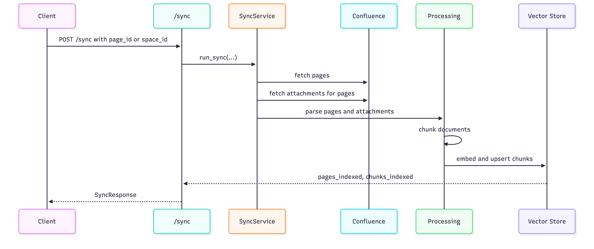
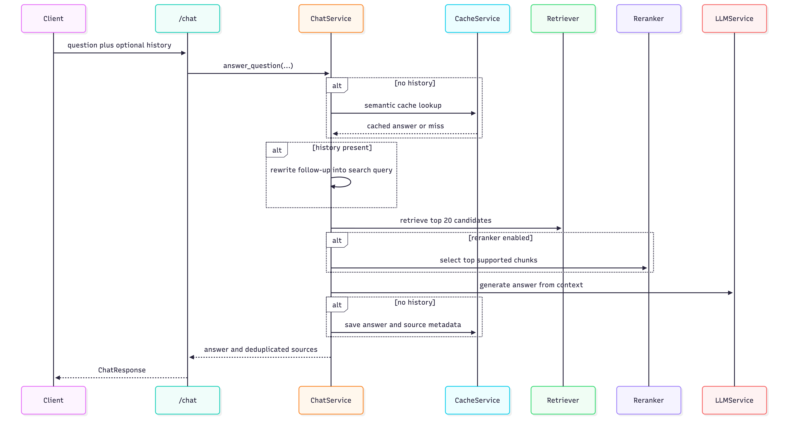

# Confluence RAG Bot

Dieses Dokument beschreibt die Features und Funktionsweise unseres RAG Bots. 
Beschrieben werden auch einige Entscheide die wir bezüglich Chunking, Evaluation, Security & weitere Themen getroffen haben.

## 1. Inhaltsverzeichnis

- [2. Motivation](#2-motivation)
- [3. Übersicht der Architektur](#3-übersicht-der-architektur)
- [4. Features](#4-features)
- [5. Projekt starten](#5-projekt-starten)
- [6. Indexing Flow](#6-indexing-flow)
- [7. Confluence Ingestion](#7-confluence-ingestion)
- [8. Inhalt Normalisierung](#8-inhalt-normalisierung)
- [9. Attachment Parsing](#9-attachment-parsing)
- [10. Chunking Strategie](#10-chunking-strategie)
- [11. Retrieval](#11-retrieval)
- [12. Reranking](#12-reranking)
- [13. Chat Flow](#13-chat-flow)
- [14. Observability](#14-observability)
- [15. Evaluation](#15-evaluation)

## 2. Motivation

Viele Unternehmen (wie auch die OST) speichern enorm viele Informationen in Confluence. Je nach Inhalt wird es enorm schwierig die richtige Seite zu finden, welche die Infos beinhaltet, die man sucht.

Das Ziel dieses Projekts ist es, dieses Wissen über eine API im Chat-Style zugänglich zu machen, wobei die Antworten stets auf der ursprünglichen Dokumentation basieren sollen.

Wir haben das Projekt in vier Hauptprobleme aufgeteilt:
1. Wissen aus Confluence zuverlässig einlesen.
2. Inhalte und Anhänge für die Suche in nützliche Abschnitte umwandeln.
3. Nur die für die Frage eines Benutzers relevantesten Abschnitte abrufen.
4. Antworten generieren, die den abgerufenen Quellen treu bleiben, und diese Quellen dem User offenlegen.

## 3. Übersicht der Architektur

```
Confluence API
      │
      ▼
 ConfluenceClient          ← Confluence Seiten werden via REST API geholt
      │
      ▼
  Normalizer + Chunker     ← HTML wird normalisiert, Headings extrahiert und in Chunks aufgeteilt
      │
      ▼
 IndexingService           ← chunks werden mit text-embedding-3-small embedded
      │
      ├──► Supabase (pgvector)   ← unser Vector-Store & semantischer Cache in der "Prod"
      └──► FAISS (local)         ← wurde lokal getestet um das Chunking möglichst effizient zu testen
                │
                ▼
         RetrieverService        ← macht Similarity-Search
                │
                ▼
          RerankerService        ← Reranker filtert top N chunks nach Relevanz, kann über die Settings ausgeschaltet werden
                │
                ▼
          LLMService             ← GPT-4.1 (z.B.) antwortet mit gegebenem Kontext
                │
                ▼
         FastAPI /chat           ← durch API-Token geschützter, rate-limitierter REST Endpunkt
```

## 4. Features

| Funktion                        | Details                                                                                                                                                                              |
|---------------------------------|--------------------------------------------------------------------------------------------------------------------------------------------------------------------------------------|
| **RAG-Pipeline**                | Confluence-Seiten → HTML-Normalisierung → Chunking → Vektor-Embeddings → Similarity Search → LLM-Reranking → Antwort                                                                 |
| **Optionen für Vector Store**   | Supabase (pgvector) für Produktion, FAISS für lokale Nutzung                                                                                                                         |
| **LLM-Reranking**               | Chunks werden nach Fragenrelevanz und Antwortunterstützung bewertet; nur die am höchsten neu gerankten Chunks werden an den Antwort-Prompt übergeben                                 |
| **Semantischer Cache**          | Identische oder nahezu identische Fragen (≥ 0,98 Kosinusähnlichkeit) werden sofort aus dem Cache beantwortet. Cache wird invalidiert, wenn Quellseiten aktualisiert werden           |
| **Langfuse-Tracing**            | Optionale Traces für Anfrage, Retrieval, Reranking, Cache und LangChain-LLM, wenn Langfuse-Zugangsdaten konfiguriert sind                                                            |
| **Konversationsverlauf**        | Multi-Turn-Chat: Der Verlauf wird in den Prompt eingefügt. Der Cache wird umgangen, wenn ein Verlauf vorhanden ist                                                                   |
| **Schutz vor Prompt Injection** | Kontext, Fragen und Verlauf werden jeweils in Sektionen eingeschlossen, mit Systemanweisungen, die verhindern, dass das LLM Benutzerinhalte als Anweisungen behandelt                |
| **`POST /sync`-Endpunkt**       | Löst eine Indexierung eines beliebigen Confluence-Bereichs (oder einzelne Seite) aus; führt Upserts (nur auf dem Remote) auf `chunk_id` aus, sodass der Aufruf wiederholt sicher ist |
| **API-Key-Authentifizierung**   | `X-API-Key`-Header wird bei jeder Anfrage benötigt                                                                                                                                   |
| **Rate Limiting**               | `/chat` — 20 Anfragen/Min., 300 Anfragen/Tag; `/sync` — 5 Anfragen/Min., pro IP-Adresse (über SlowAPI)                                                                               |

## 5. Projekt starten

Um die API lokal zu starten ist es wichtig als Erstes die .env Variablen zu setzen.

```bash
uv sync
cp .env.example .env
```

Im `.env` müssen mindestens `OPENAI_API_KEY`, `CONFLUENCE_API_KEY`, `CONFLUENCE_BASE_URL`, `API_KEY` und je nach Vector-Store die Supabase- oder FAISS-Konfiguration gesetzt werden.

Gestartet wird die FastAPI-App mit:

```bash
uv run uvicorn app.api.chat:app --host 0.0.0.0 --port 3000
```

Nach dem Start sollte zuerst `POST /sync` mit dem `X-API-Key`-Header ausgeführt werden, damit Inhalte indexiert werden. Danach kann der Chat über `POST /chat` verwendet werden.

## 6. Indexing Flow

Gestartet wird die Indexierung über ```POST /sync```, welche in ```app/services/sync_service.py``` implementiert wird.



Remote (auf Coolify) haben wir für die Indexierung einen Cron-Job eingerichtet, welcher regelmässig den `/sync` Endpunkt anstösst.

## 7. Confluence Ingestion

Der Confluence Client wurde in ```app/confluence/client.py``` implementiert.
Interessante Details:
- Requests teilen eine "shared authenticated" ```requests.Session```
- Confluence-API Aufrufe haben ein 60 Sekunden timeout
- Schlägt ein Request fehl, versuchen wir es dreimal erneut (Ausnahme ConfluenceAPIError). Aus eigener Erfahrung haben wir gemerkt, dass bei gewissen Fehlern es meist nach einem Retry wieder funktioniert.

Seiten können nach Bereich (Space) oder nach Seiten-ID geholt werden. Wenn eine Seite weitere Seiten beinhaltet werden auch diese heruntergeladen.

Wenn das Herunterladen von Anhängen für eine Seite fehlschlägt, loggt das System den Fehler und fährt mit der Indexierung der verbleibenden Seiten fort. Ein beschädigter Anhang sollte nicht verhindern, dass der Rest der Wissensbasis indexiert wird.

## 8. Inhalt Normalisierung

Der Confluence Page-Body besteht aus HTML. Der Parser `app/processing/normalize.py` konvertiert dies in normalisierten Text und Sektionen mit Headers.

Die Confluence Seiten können auch komplizierteren Inhalt beinhalten, z.B. durch Plugins. Diese Inhalte haben wir für diesen MVP ignoriert und uns auf die "standard" HTML Strukturen fokussiert, wie Headings, Paragrafen, Listen, Tabellen etc.

Der parser verwendet einen `heading_stack`, so dass der Text unter einem Heading diesem zugewiesen bleibt. Am besten ist dies anhand eines Beispiels ersichtlich:
```
<h2>Access</h2>
<h3>VPN</h3>
<p>Use the OSR VPN when accessing internal systems.</p>
```
Wird zu einer Section mit diesem Heading-Path:
```
["Access", "VPN"]
```

Dieser Heading-Path wird in den Metadaten des Chunks gespeichert.

## 9. Attachment Parsing

Viele Confluence Seiten beinhalten Anhänge, wie z.B. PDFs. Deshalb haben wir es als wichtig erachtet auch diese einzubeziehen. 
Zurzeit unterstützen wir die folgenden Dateiformate:

- PDF
- Markdown
- DOCX
- JSON
- plain text
- CSV
- XML
- YAML
- SQL

Nicht unterstütze Formate werden übersprungen.

Attachment-Chunks beinhalten den Titel der Parent Seite, Dateiname und Dateityp. Dies verbessert den Retrieval-Prozess, denn so kann der Kontext des Inhalts besser bestimmt werden.

## 10. Chunking Strategie

Den grössten Einfluss hatte unserer Erfahrung nach unser Chunking. Deshalb haben wir hier auch mit verschiedenen Ansätzen experimentiert. Am meisten Erfolg hatten wir mit der Parent-Child Strategie.

- Benachbarte Blöcke unter derselben Überschrift werden zu übergeordneten Abschnitten zusammengefasst
- Kompakte untergeordnete Chunks werden fürs Retrieval embedded
- Die Chunks enthalten den Kontext des übergeordneten Abschnitts in den Metadaten
- Die Antwortgenerierung erhält den übergeordneten Chunk, sofern dieser verfügbar ist
- Dadurch bleibt der Abruf präzise, während das Antwortmodell genügend Kontext für Anleitungen, Listen und verwandte Absätze erhält.

Mit dieser Strategie können wir auch besser mit Listen umgehen (von diesen gibt es einige im OST-Confluence).

## 11. Retrieval

Retrieval ist implementiert in `app/embeddings/retriever.py`.

Der Retriever...

- Erstellt das konfigurierte Embedding-Model
- Lädt den konfigurierten Vector-Store
- Gibt einen LangChain Retriever zurück
- Nutzt Similarity-Search
- Holt die top 20 Kandidaten

Wir holen absichtlich viele Einträge, so geben wir dem Reranker genug, um diese grosszügig zu filtern und die bestmögliche Antwort zu erstellen.

## 12. Reranking

Der Reranker wurde in `app/reranking/reranker.py` implementiert und fordert von einem LLM ein JSON, dass strikt dieser Form entspricht:
```
{
  "results": [
    {
      "index": 0,
      "relevance": 0.91,
      "supports_answer": true,
      "reason": "contains the relevant module list"
    }
  ]
}
```

Wir nehmen daraus nur Antworten wo `supports_answer`=True. Results werden nach dem Config-Wert `RERANKER_TOP_N` limitiert. Default ist bei 5.
Falls trotz den strikten Anweisungen ein invalides JSON ankommt, machen wir ein Fallback auf die ersten `top_n` Dokumente.

## 13. Chat Flow

Unser Chat-Flow wird in `app/services/chat_service.py` orchestriert. Dieser zeigen wir am besten am Mermaid-Diagram.



## 14. Observability

Für das Tracing verwenden wir wie in der Vorlesung Langfuse. Dieses könnte optional auch mit der Config ausgeschaltet werden, wenn eine bessere Performance gewünscht ist.

Tracen tun wir Folgendes:
- Chat-Request
- Cache-Lookup
- Verlaufsbasierte Umformulierung der Abfrage
- Retrieval
- Reranking
- LLM-Generierung über LangChain-Callbacks


## 15. Evaluation

Zur Evaluierung verwenden wir RAGAS.

Die Dataset-Datei ist im JSONL-Format aufgebaut. Jede Zeile entspricht einem Evaluationsfall.

Standardmässig verwendet der Runner `resources/datasets/generated_cases.jsonl`, da dieses Dataset
Referenzantworten enthält und dadurch alle Metriken berechnet werden können.

Um Testfälle zu generieren, verwenden wir dieses Skript:
```bash
uv run python scripts/generate_testcases.py --space-id 720898 --page-limit 20 --min-chars 500
```

Diese Metriken werden immer berechnet:

- `faithfulness`
- `answer_relevancy`

Diese nur bei vorhandener `reference_answer`:

- `factual_correctness`
- `context_precision`
- `context_recall`
- 
Jeder Lauf schreibt die resultierenden Artefakte nach `resources/evaluation_runs/`.

```bash
uv run python -m app.evaluation.runner
```

Bei den Unit-Tests haben wir auf eine Testabdeckung von 60% + abgezielt. 
